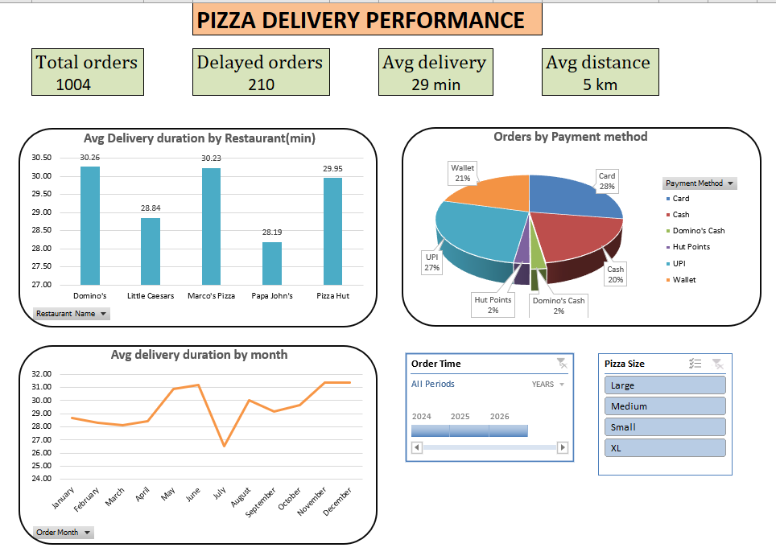

# 🍕 Pizza Delivery Performance Dashboard | Excel Data Analytics

## 📌 Project Overview

The **Pizza Delivery Performance Dashboard** is an interactive data analytics project built using Microsoft Excel. It analyzes pizza delivery operations to understand delivery duration, delayed orders, restaurant performance, payment preferences, and monthly delivery trends.

The project transforms raw order-level data into an interactive dashboard using KPI cards, PivotTables, charts, slicers, and a timeline. It demonstrates how Excel can be used to monitor operational performance and communicate business insights.

**Project Type:** Minimum Viable Product (MVP)  
**Domain:** Food Delivery & Operations Analytics  
**Tool:** Microsoft Excel  
**Author:** Nirpal Solanki

---

## 🎯 Project Objectives

- Monitor total orders and delayed orders.
- Calculate average delivery duration and delivery distance.
- Compare delivery performance across restaurants.
- Analyze monthly changes in delivery duration.
- Understand customer payment method preferences.
- Explore order data using interactive slicers and a timeline.
- Practice data cleaning, calculated columns, PivotTables, and dashboard development.

---

## 🛠️ Tools & Technologies

- **Microsoft Excel** — Data analysis and dashboard development.
- **PivotTables** — Summarizing order data by restaurant, month, and payment method.
- **PivotCharts** — Visualizing delivery performance and payment distributions.
- **Slicers** — Filtering the dashboard by pizza size.
- **Timeline** — Filtering orders by order date.
- **Excel Formulas** — Calculating KPIs and summarizing results.
- **Data Visualization** — Presenting operational metrics through charts and KPI cards.

---

## 📊 Dashboard Preview

The dashboard provides a consolidated view of pizza delivery performance through four KPI cards, three charts, a date timeline, and a pizza-size slicer.

### Key Performance Indicators (KPIs)

| KPI | Value |
|---|---:|
| Total Orders | 1,004 |
| Delayed Orders | 210 |
| Average Delivery Duration | 29.49 minutes |
| Average Delivery Distance | 4.95 km |

*Values are taken from the workbook's summary table. The dashboard displays rounded values for readability.*

### Dashboard Components

**1. Average Delivery Duration by Restaurant**

A column chart comparing the average delivery duration across five pizza restaurant brands.

It helps identify differences in average delivery times and highlight restaurants for further operational investigation.

**2. Orders by Payment Method**

A pie chart showing how orders are distributed across payment methods, including Card, Cash, UPI, Wallet, Hut Points, and Domino's Cash.

It helps compare the popularity of different payment options.

**3. Average Delivery Duration by Month**

A line chart displaying average delivery duration across the twelve calendar months.

It helps identify monthly variations, changes in delivery performance, and periods that may require further investigation.

**4. Order Date Timeline**

An interactive timeline that allows users to filter order records by date and year.

**5. Pizza Size Slicer**

An interactive slicer for filtering the dashboard by Large, Medium, Small, and XL pizza sizes.

These interactive controls make it easier to explore subsets of the order data.

---

## 📁 Dataset Overview

The workbook contains **1,004 order records and 25 columns** in its main order-level dataset.

The data covers orders dated from January 2024 through July 2026.

### Important Columns

| Column | Description |
|---|---|
| Order ID | Unique order identifier |
| Restaurant Name | Name of the pizza restaurant |
| Location | Order location |
| Order Time | Date and time the order was placed |
| Delivery Time | Date and time of delivery |
| Delivery Duration (min) | Recorded delivery duration in minutes |
| Pizza Size | Size of the ordered pizza |
| Pizza Type | Type of pizza ordered |
| Toppings Count | Number of toppings |
| Distance (km) | Delivery distance in kilometers |
| Traffic Level | Recorded traffic category |
| Payment Method | Method used to pay for the order |
| Is Peak Hour | Indicates whether the order was placed during peak hours |
| Is Weekend | Indicates whether the order was placed on a weekend |
| Delivery Efficiency (min/km) | Delivery duration relative to distance |
| Topping Density | Calculated topping-related metric |
| Order Month | Month extracted from the order date |
| Payment Category | Grouped payment classification |
| Estimated Duration (min) | Estimated delivery duration |
| Delay (min) | Calculated delay-related metric |
| Is Delayed | Indicates whether an order is classified as delayed |
| Pizza Complexity | Calculated pizza-related metric |
| Traffic Impact | Calculated traffic-related metric |
| Order Hour | Hour extracted from the order time |
| Restaurant Avg Time | Average delivery duration for the restaurant |

---

## 🔍 Key Findings

The following observations can be derived from the workbook's current summary and chart data.

### 1. Delivery Delays

- Total orders: **1,004**
- Delayed orders: **210**
- Delayed orders represent approximately **20.92%** of all orders.

This metric provides an overview of the share of orders classified as delayed.

### 2. Restaurant Performance

The average delivery durations shown in the restaurant chart are:

| Restaurant | Average Delivery Duration |
|---|---:|
| Domino's | 30.26 minutes |
| Little Caesars | 28.84 minutes |
| Marco's Pizza | 30.23 minutes |
| Papa John's | 28.19 minutes |
| Pizza Hut | 29.95 minutes |

Among the displayed restaurants, Domino's has the highest average delivery duration, while Papa John's has the lowest.

These are comparisons of average delivery duration, not proof of the causes of the differences.

### 3. Payment Method Distribution

The dataset contains orders paid through multiple methods, including:

- Card
- UPI
- Wallet
- Cash
- Hut Points
- Domino's Cash

The dashboard visualizes their distribution to make payment preferences easier to compare.

### 4. Monthly Delivery Trends

The line chart shows variation in average delivery duration across the months.

The monthly averages range from approximately **26.53 minutes in July** to **31.38 minutes in December** in the current dataset.

These variations can be investigated further using order volume, traffic level, restaurant, and delivery distance.

---

## 📈 Analytical Value

This project demonstrates how operational data can be used to answer practical business questions:

- How many orders were processed?
- What proportion of orders were delayed?
- Which restaurant has the highest or lowest average delivery duration?
- How does delivery performance vary by month?
- Which payment methods are used most frequently?
- How do delivery metrics change when filtering by pizza size or date?

The dashboard helps users explore these questions without manually reviewing all 1,004 records.

---

## 🧠 Skills Demonstrated

- Excel data analysis
- KPI calculation and presentation
- Data summarization with PivotTables
- PivotChart creation
- Interactive dashboard development
- Slicer and timeline integration
- Date and time analysis
- Calculated columns and derived metrics
- Operational performance analysis
- Data visualization and interpretation
- Business insight communication

---

## 📂 Recommended Repository Structure

```text
Pizza-Delivery-Performance-Dashboard/
│
├── README.md
├── Enhanced_pizza_sell_data_2024-25 (1).xlsx
└── images/
    └── pizza-delivery-dashboard.png
```

The structure above is a recommendation. Upload your actual workbook and dashboard screenshot, and update the filenames if you rename them.

### Dashboard Screenshot

To display your dashboard on the GitHub repository page, upload your screenshot to the `images` folder and include:

```markdown
## Dashboard Screenshot


```

---

## 🚀 How to Use

1. Download the Excel workbook from this repository.
2. Open it in Microsoft Excel.
3. Navigate to the Dashboard sheet.
4. Review the KPI cards and charts.
5. Use the pizza-size slicer to filter the data.
6. Use the order-time timeline to explore date-based performance.
7. Review the underlying data and PivotTables for additional analysis.

**Compatibility:** Some PivotTable, slicer, timeline, or other Excel features may behave differently in Excel for the web or alternative spreadsheet applications. Use a compatible desktop version of Excel if a feature is unavailable.

---

## ⚠️ Limitations

- The dashboard summarizes the supplied dataset and may not represent actual real-world delivery operations.
- Average delivery duration alone does not explain why delays occur.
- The delayed-order classification depends on the workbook's existing logic.
- The dataset contains records through July 2026, so the filename should be updated if it is intended to describe the full date range.
- The analysis could be strengthened by examining order volume, traffic, delivery distance, and restaurant performance together.
- Data consistency should be reviewed before drawing conclusions from restaurant-level comparisons.

---

## 🔮 Future Improvements

- Add a delayed-order percentage KPI.
- Add an on-time delivery rate KPI.
- Include total and average delivery distance by restaurant.
- Analyze delivery duration by traffic level and peak-hour status.
- Add a comparison of average and median delivery duration.
- Improve data validation and standardize restaurant names.
- Add more interactive charts and filtering options.
- Add a documented data-cleaning process.
- Include additional insights based on the filtered dataset.

---

## 👨‍💻 Author

**Nirpal Solanki**

Aspiring Data Analyst | Microsoft Excel | Python | Data Visualization

This project demonstrates practical learning in Excel dashboards, operational analytics, KPI reporting, and interactive data visualization.

---

## 📄 License

This project is intended for educational and portfolio purposes. Before sharing the workbook or its underlying data, ensure that you have the necessary rights to distribute them.

---

## ⭐ Conclusion

The Pizza Delivery Performance Dashboard demonstrates how Microsoft Excel can transform order-level data into an interactive operational reporting tool.

By combining KPIs, restaurant comparisons, payment analysis, monthly trends, slicers, and a timeline, the project provides a foundation for understanding pizza delivery performance and developing more advanced analytics solutions.

If you find this project useful, consider starring the repository on GitHub.
